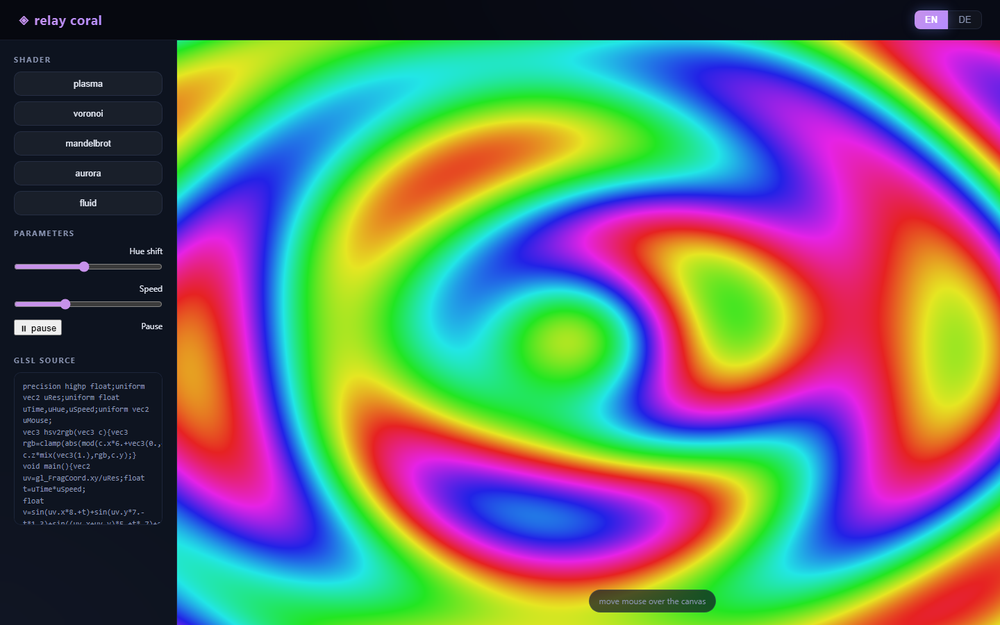
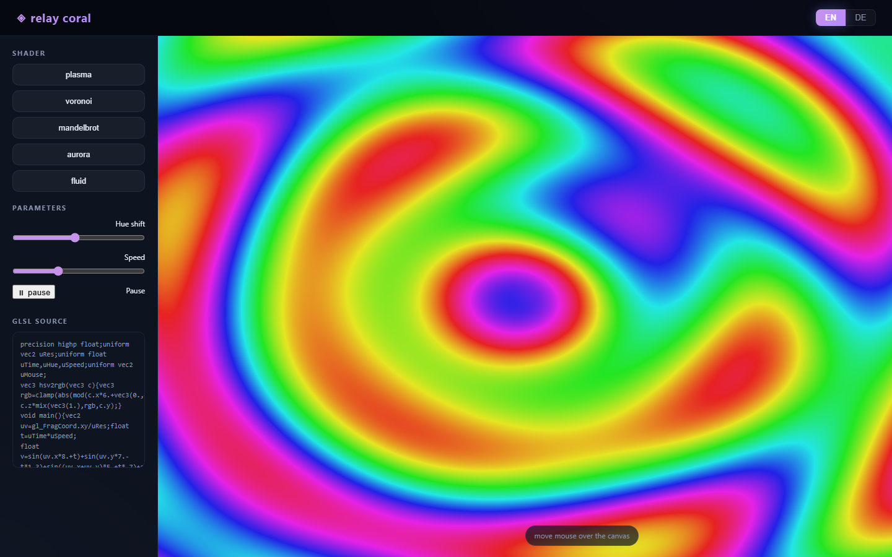
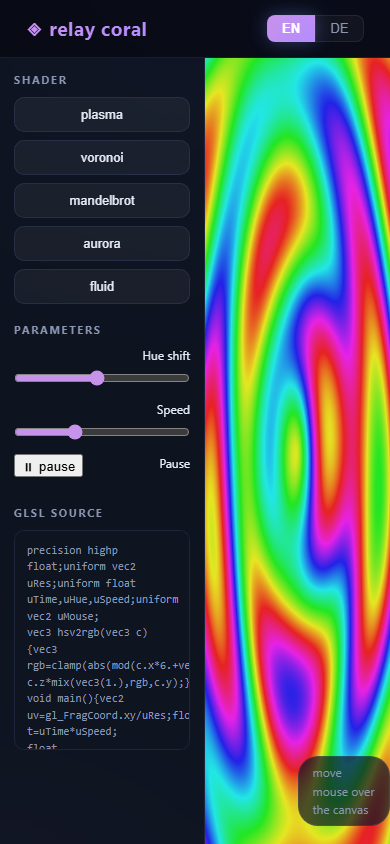

# Relay Coral — Shader Lab

A WebGL shader playground: five hand-written GLSL fragment shaders (plasma, voronoi, mandelbrot, aurora, fluid) with live hue/speed/mouse uniforms and inspectable source.

<div align="center">


**[Live Demo](https://ruslanfridenli.github.io/relay-coral/)** · **[Deutsch ↓](#-deutsch)**

</div>

---

## Screenshots







## Features

- Five GLSL fragment shader presets
- Live uniforms: hue, speed, mouse interaction
- Raw GLSL source viewer
- 60fps WebGL rendering
- Keyboard/mouse/touch friendly
- English/German interface

## Local development

```bash
git clone https://github.com/ruslanfridenli/relay-coral.git
cd relay-coral
# open index.html in a browser, or serve statically:
npx serve .
```

No build step, no dependencies — pure static site.

---

## 🇩🇪 Deutsch

### Relay Coral — Shader-Labor

Ein WebGL-Shader-Playground: fünf handgeschriebene GLSL-Fragmentshader (Plasma, Voronoi, Mandelbrot, Polarlicht, Fluid) mit Live-Farbton-/Tempo-/Maus-Uniforms und einsehbarem Quelltext.

### Funktionen

- Fünf GLSL-Fragmentshader-Presets
- Live-Uniforms: Farbton, Tempo, Maus-Interaktion
- GLSL-Quelltext-Ansicht
- 60fps-WebGL-Rendering
- Tastatur-/Maus-/Touch-tauglich
- Englische/deutsche Oberfläche

### Lokale Entwicklung

```bash
git clone https://github.com/ruslanfridenli/relay-coral.git
cd relay-coral
npx serve .
```

Reine statische Seite — kein Build-Schritt, keine Abhängigkeiten.

---

## ☕ Support / Unterstützen

Wenn dir diese Website beim Lernen hilft, würde mir eine Spende sehr viel bedeuten und dabei helfen, sie weiterzuentwickeln. Alternativ kannst du das Projekt mit einem Stern im github repo unterstützen. Vielen Dank!

- Solana: `zQpgZ6nGigww7vYpz3Qqxb1BT44kqS567vFaLTeHagS`
- Ethereum: `0x9c4fE1B2e9a1A9c22312c8296BB088Ca0e8F1B4e`
- Bitcoin: `bc1p2jltk9ya9kyzv35d8kxn7mmg9jqkx66cqtgzqwe75zlr4v9jk4hsv468q7`

---

Made with care. Feedback welcome via issues.
